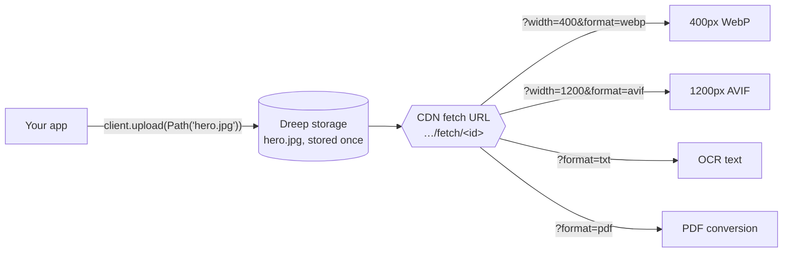
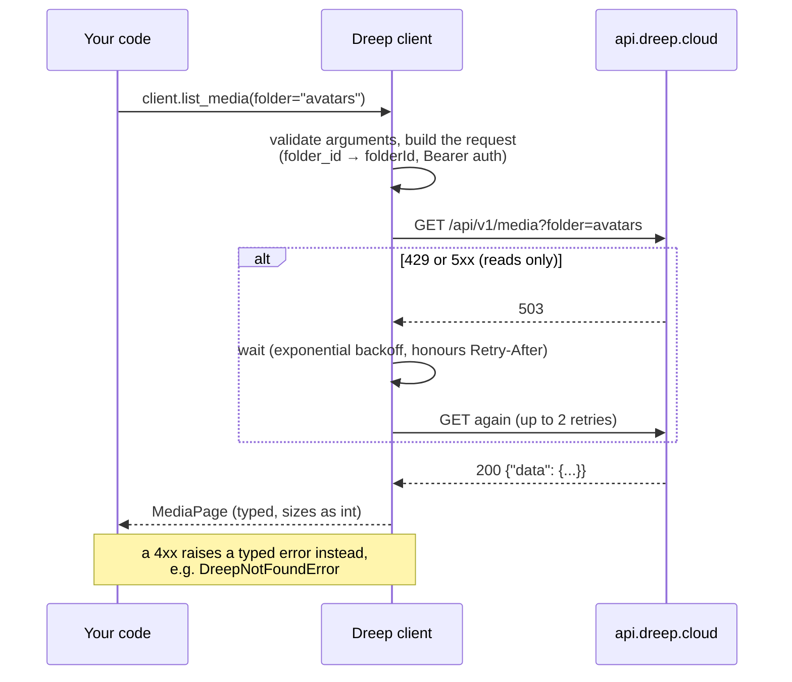
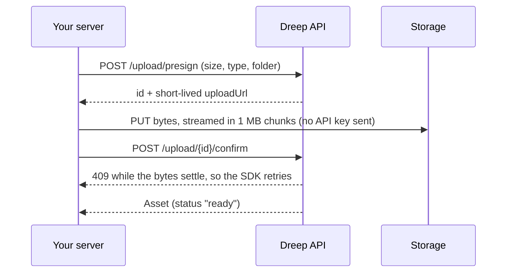

<div align="center">

<a href="https://dreep.cloud">
  
</a>

<h1>Dreep Python SDK</h1>

<p><strong>The official Python client for <a href="https://dreep.cloud">Dreep</a>, the universal media API.</strong><br>
Upload, store, transform and deliver images, videos and documents from Python.</p>

[](https://pypi.org/project/dreep/)
[](https://pypi.org/project/dreep/)
[](https://github.com/IndigoSoftwares21/dreep-python/actions/workflows/ci.yml)
[](https://mypy.readthedocs.io/)
[](LICENSE)

[Documentation](https://docs.dreep.cloud) ·
[API reference](https://docs.dreep.cloud/api-reference/upload/upload-media) ·
[Report a bug](https://github.com/IndigoSoftwares21/dreep-python/issues/new?template=bug_report.yml) ·
[Request a feature](https://github.com/IndigoSoftwares21/dreep-python/issues/new?template=feature_request.yml)

</div>

---

## Why this SDK

| | |
| :- | :- |
| **Sync and async** | `Dreep` and `AsyncDreep` share one API. Async runs on asyncio and trio. |
| **Fully typed** | Ships `py.typed`. Transforms are a `TypedDict` with `Literal` values, so `fit="squish"` fails type-checking before it ships. |
| **Signed URLs that work** | The SDK rounds sizes the same way the API does before it checks a signature, so a transformed signed link doesn't fail with a `401`. |
| **Large files without the memory** | `upload_presigned()` streams from disk straight to storage. |
| **Safe by default** | Only reads are retried. Your API key goes only to the API, and never appears in logs or reprs. |
| **Lightweight** | One dependency, [`httpx`](https://www.python-httpx.org/). |

## Installation

```bash
pip install dreep
```

Requires Python 3.10 or later. Create an API key on the **API Keys** page of the
[Dreep dashboard](https://dreep.cloud) and make it available to your app:

```bash
export DREEP_API_KEY="drp_live_..."
```

## Quickstart

```python
from pathlib import Path
from dreep import Dreep

client = Dreep()  # reads DREEP_API_KEY

# 1. Upload: the original is stored once
asset = client.upload(Path("hero.jpg"), folder="marketing/2026")

# 2. Deliver any size or format from that one original. No network call.
thumbnail = client.url(asset, {"width": 400, "format": "webp"})
banner = client.url(asset, {"width": 1600, "height": 600, "fit": "cover"})

print(asset.url)   # https://cdn.dreep.cloud/api/v1/fetch/2f928a3f….jpg
print(thumbnail)   # …/fetch/2f928a3f….jpg?format=webp&width=400
```

The async client works the same way:

```python
from dreep import AsyncDreep

async with AsyncDreep() as client:
    asset = await client.upload(Path("hero.jpg"))
    async for item in client.list_all_media(folder="marketing"):
        print(item.filename, item.size_bytes)
```

> [!IMPORTANT]
> Your API key can read, upload and delete every asset in the project. Keep it on the
> server. For uploads from a browser, use the [presigned flow](#large-files-go-straight-to-storage):
> your server hands the browser a short-lived upload URL instead.

## How it works

### One original, many variants

Dreep stores each file once. Every resized, cropped or converted version is produced on
request from a URL, then cached on the CDN. You don't have to transform files on upload:
keep the original and ask for what you need when you deliver it.



`client.url(asset, {...})` builds those URLs locally without any network call, so it's
safe to call while rendering a page.

### What happens when you call a method



- **Arguments are checked before anything is sent.** Passing both `folder=` and
  `folder_id=`, or misspelling a transform key such as `"widht"`, raises immediately
  instead of quietly returning the original.
- **Responses come back as typed, frozen dataclasses** with snake_case attributes. Numbers
  the API sends as strings (`sizeBytes: "245000"`) are converted to `int`. Any field the
  SDK doesn't model yet is still available in `.raw`.
- **Only reads are retried.** Retrying an upload could store it twice and bill it twice.

### Large files go straight to storage

`upload()` sends the file through the API in one request, which suits files up to a few
hundred MB. `upload_presigned()` sends the bytes directly to storage instead, streaming
them from disk:



```python
# Everything on your server
asset = client.upload_presigned(Path("video.mp4"), folder="uploads/2026")

# Upload from a browser: presign on the server, the browser PUTs the bytes, confirm on the server
upload = client.presign_upload(content_type="video/mp4", size_bytes=84_000_000)
#   ... send upload.id and upload.upload_url to the browser ...
asset = client.confirm_upload(upload.id)
```

### Signed URLs, done the way the API checks them

Files in a **signed** folder can only be fetched with a link that carries an expiry time
(`exp`) and an HMAC signature (`sig`). When that link also includes a transform, the API
rounds some values to fixed sizes before it checks the signature:

| You ask for | The API checks against |
| :- | :- |
| `width=803` | `828` (rounded up to the next fixed width) |
| `quality=82` | `85` (rounded to the nearest fixed quality) |
| `dpr=1.5` | `2` |

If you sign `803` by hand, the API checks `828` and returns `401`, with nothing in the URL
to tell you why. `client.signed_url()` does the same rounding before signing, so the link
works:

```python
client = Dreep(signing_secret="...")  # or set DREEP_SIGNING_SECRET
link = client.signed_url(asset, expires_in=3600, transform={"width": 803})
```

Anyone holding a signed link can fetch the file until it expires, without an API key, so
keep expiry times short.

## Recipes

<details open>
<summary><strong>Folders and access control</strong></summary>

```python
# Uploads create folders as needed. Create one yourself only to set its access control.
client.create_folder(path="courses/premium", access_control_type="signed")

# Upload into a nested path, creating any missing folders
asset = client.upload(Path("lesson.mp4"), key="courses/premium/lesson-1.mp4")

# Every folder in the project, each with its full path
for folder in client.list_folders():
    print(folder.path, folder.access_control_type)
```

</details>

<details>
<summary><strong>Listing and deleting</strong></summary>

```python
page = client.list_media(folder="courses", page=1, limit=50)
print(f"{len(page)} of {page.pagination.total}")

# Every asset across every page, one request per page, fetched lazily
for item in client.list_all_media(folder="courses", recursive=True):
    print(item.filename, item.size_bytes)

client.delete_media(asset.id)  # also removes its cached transforms
```

</details>

<details>
<summary><strong>Presets: name a transform once</strong></summary>

```python
client.create_preset(
    key="thumb",
    name="Thumbnail",
    transform={"width": 200, "height": 200, "fit": "cover", "format": "webp"},
)
client.url(asset, {"preset": "thumb"})  # change the preset later and every URL using it follows
```

</details>

<details>
<summary><strong>Background removal</strong></summary>

```python
cutout = client.remove_background(Path("product.jpg"), folder="products")

# One cutout can be served on any background colour, and only the removal is billed
client.url(cutout, {"bg": "ffffff"})
client.url(cutout, {"bg": "000000"})
```

</details>

<details>
<summary><strong>Text extraction (OCR)</strong></summary>

```python
result = client.extract_text(Path("invoice.pdf"), include_blocks=True)
print(result.text)
for block in result.blocks:
    print(block)  # line-level bounding boxes

# For an asset already in Dreep: no re-upload, and cached after the first read
print(client.fetch_text(asset))
```

</details>

<details>
<summary><strong>Document conversion</strong></summary>

```python
pdf = client.convert_document(Path("contract.docx"), format="pdf", folder="contracts")
slide = client.convert_document(Path("deck.pdf"), format="png", page=2)

if not pdf.is_ready:  # very long documents keep converting in the background
    print("Still converting; its URL answers 202 until it's ready")
```

</details>

<details>
<summary><strong>Usage</strong></summary>

```python
usage = client.get_usage()
print(f"{usage.storage_bytes / 1024**3:.2f} GB across {usage.image_count + usage.file_count} files")
```

</details>

Runnable scripts are in [`examples/`](examples/).

## API reference

| Method | What it does | Endpoint |
| :- | :- | :- |
| `upload(file, …)` | Upload in one multipart request, optionally transforming it first | `POST /upload` |
| `presign_upload(…)` | Start a direct-to-storage upload | `POST /upload/presign` |
| `confirm_upload(id, …)` | Finalise a presigned upload | `POST /upload/{id}/confirm` |
| `upload_presigned(file, …)` | Presign, stream the PUT, and confirm in one call | all three |
| `url(asset, transform)` | Delivery URL with a transform | none |
| `signed_url(asset, expires_in=…)` | Time-limited URL for a signed folder | none |
| `list_media(…)` / `list_all_media(…)` | One page / every page, fetched lazily | `GET /media` |
| `delete_media(id)` | Delete an asset and its cached transforms | `DELETE /media/{id}` |
| `create_folder(…)` / `list_folders(…)` | Folders and access control | `/folders` |
| `create_preset(…)` / `list_presets()` / `delete_preset(id)` | Named transforms | `/presets` |
| `remove_background(file, …)` | Cut out the subject, keeping the alpha channel | `POST /bg-remove` |
| `extract_text(file, …)` | OCR an image or PDF | `POST /ocr` |
| `fetch_text(asset)` | OCR text of an asset already in Dreep | `GET fetch/{id}?format=txt` |
| `convert_document(file, format=…)` | Word ↔ PDF, spreadsheets, PDF page to image | `POST /convert` |
| `get_usage()` | Storage and object counts | `GET /usage` |

`file` can be `bytes`, a `pathlib.Path`, or a binary file object. A plain `str` is rejected
on purpose, because it could be either a path or the file's content.

### Transform parameters

| Key | Applies to | Values |
| :- | :- | :- |
| `format` | image, video, document | `webp`, `avif`, `jpeg`, `png`, `mp4`, `hls`, `pdf`, `docx`, `txt` (OCR), … |
| `width`, `height` | image, video | pixels, max 4000 |
| `fit` | image, video | `cover`, `contain`, `fill`, `inside`, `outside` |
| `quality` | image, video | 1–100 |
| `gravity` | image | `center`, `north`, …, `attention`, `entropy` |
| `crop` | image | `"left,top,width,height"` or a 4-tuple |
| `dpr` | image | 1–3 |
| `rotate` | image | `90`, `180`, `270` |
| `blur` | image | 0.3–100 |
| `bg` | image | hex without `#`, e.g. `"ffffff"` |
| `radius` | image | pixels, or `"max"` for a circle |
| `trim_start`, `trim_end` | video | seconds |
| `video_codec`, `fps` | video | `h264`, `vp8`, `vp9`, `hevc`; frames per second |
| `page` | PDF → image | 1-based page number |
| `preset` | any | a saved preset key |

## Errors

Every failure raises a subclass of `DreepError`. Catch `DreepError` for everything, or a
specific subclass for the cases you want to handle differently:

```python
from dreep import DreepError, DreepLimitError, DreepNotFoundError

try:
    client.upload(Path("hero.jpg"))
except DreepLimitError as error:          # 402: the plan ran out
    print(f"{error.feature_key}: {error.used} of {error.limit}")
except DreepNotFoundError:                # 404
    ...
except DreepError as error:               # everything else
    print(error.status, error.message, error.request_id)
```

| Exception | When |
| :- | :- |
| `DreepValidationError` | 400 / 413: invalid parameters or file too large (`validation_errors`) |
| `DreepAuthError` | 401 / 403: missing, malformed or revoked key |
| `DreepLimitError` | 402: plan limit reached (`feature_key`, `used`, `limit`) |
| `DreepNotFoundError` | 404: unknown asset, folder, preset or upload |
| `DreepConflictError` | 409: confirming before the bytes landed |
| `DreepRateLimitError` | 429 (`retry_after`) |
| `DreepServerError` | 5xx |
| `DreepProcessingError` | 202 where a finished result was needed |
| `DreepConnectionError` / `DreepTimeoutError` | No response arrived |

## Retries and timeouts

- **Retries.** GET requests are retried twice on 429, 5xx and connection failures, using
  exponential backoff with jitter and honouring `Retry-After`. Writes are never retried
  automatically. Set `max_retries=0` to turn retries off.
- **Timeouts.** JSON calls time out after 30 seconds. Uploads have no default limit, because
  a large file can take a long time; pass `timeout=` on the call to bound one:
  `client.upload(path, timeout=120)`.

## Configuration

| Argument | Environment variable | Default |
| :- | :- | :- |
| `api_key` | `DREEP_API_KEY` | required |
| `signing_secret` | `DREEP_SIGNING_SECRET` | none (needed only for `signed_url`) |
| `timeout` | | `30.0` seconds |
| `max_retries` | | `2` |
| `http_client` | | an internal `httpx` client; pass your own for proxies or custom transports |

The SDK logs retries to the `dreep` logger.

## Contributing

Contributions are welcome. Every pull request is linked to an issue and reviewed by the
maintainers. [CONTRIBUTING.md](CONTRIBUTING.md) walks through the whole process, from
picking an issue to getting approval.

## License

[MIT](LICENSE) © Dreep
