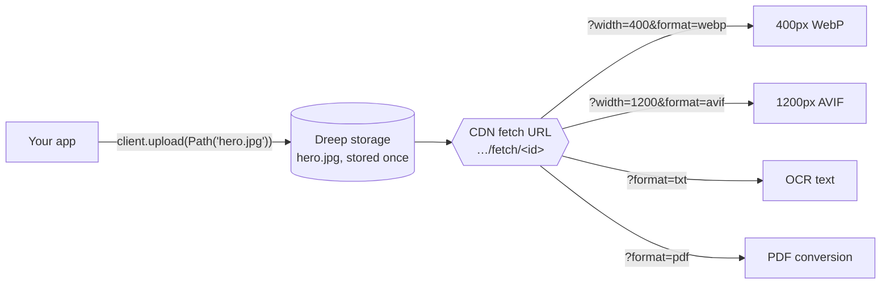
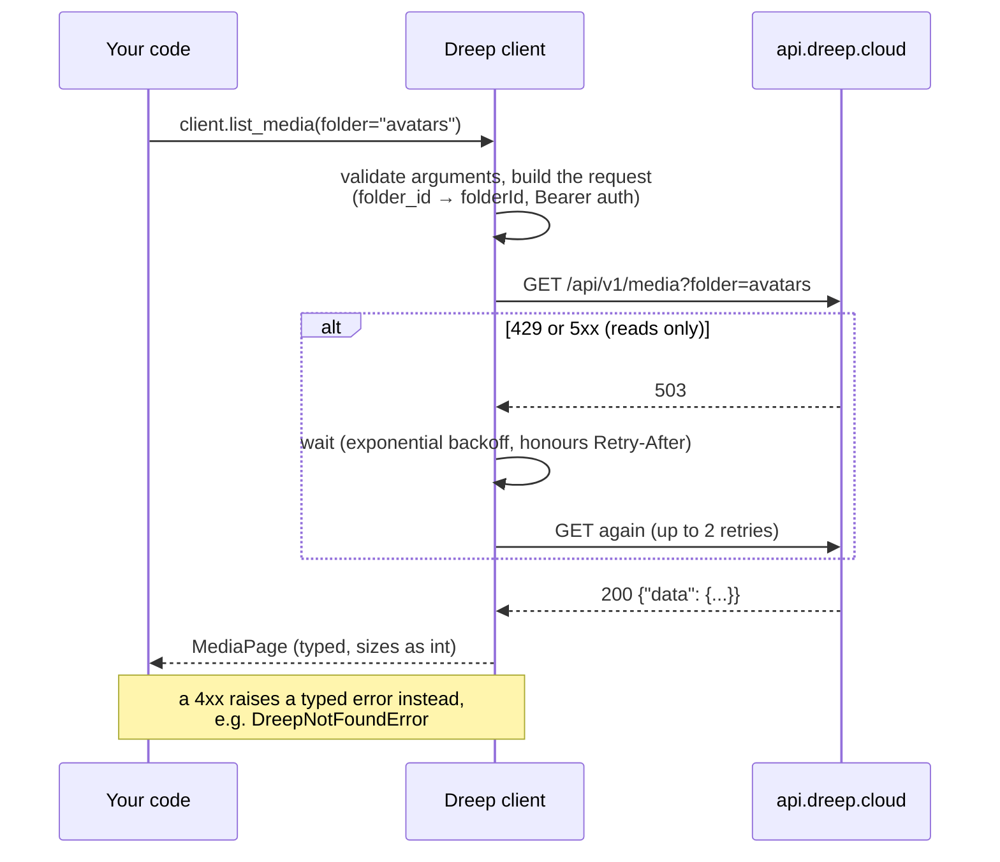
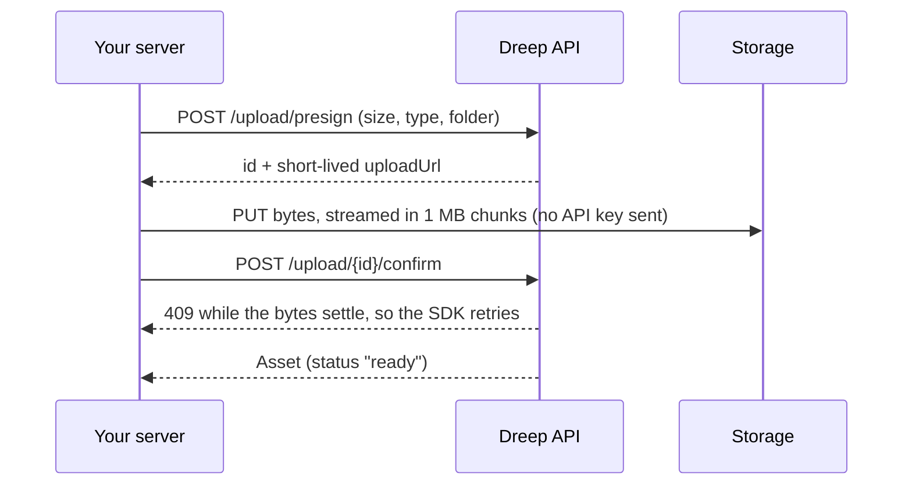

# dreep-python

The official Python SDK for [Dreep](https://dreep.cloud): media storage, image and
video transformation, document conversion, OCR and background removal.

- **Sync and async.** `Dreep` and `AsyncDreep` have identical APIs (asyncio and trio).
- **Fully typed.** Ships `py.typed`; transforms are a `TypedDict` with `Literal` values,
  so `fit="squish"` is a type error.
- **Correct signed URLs.** The API snaps width, height, quality and dpr onto fixed sizes
  before it verifies a signature. The SDK applies the same snapping, so a link for
  `width=803` is signed the way the API will check it (as `828`).
- **Safe by default.** Only reads are retried. The API key is never sent anywhere except
  the API, and it never appears in reprs or logs.
- **One dependency:** `httpx`.

## Installation

```bash
pip install dreep
```

Requires Python 3.10 or later.

## Quickstart

```python
from pathlib import Path
from dreep import Dreep

client = Dreep()  # reads DREEP_API_KEY; or Dreep("drp_live_…")

# Upload, resized and converted on the way in
asset = client.upload(
    Path("hero.jpg"),
    folder="marketing/2026",
    transform={"width": 1200, "format": "webp"},
)
print(asset.url)

# Build a smaller variant; no network call
client.url(asset, {"width": 400})
```

Async works the same way:

```python
from dreep import AsyncDreep

async with AsyncDreep() as client:
    asset = await client.upload(Path("hero.jpg"))
    async for item in client.list_all_media(folder="marketing"):
        print(item.filename)
```

> **Keep your API key server-side.** It can read, upload and delete every asset in the
> project. For browser uploads, presign on your server (see below) and let the browser
> PUT the bytes.

## How it works

### One original, many variants

Dreep stores each file once. Every resized, cropped or converted version is produced on
request from a URL, then cached on the CDN. You don't have to transform files on upload:
keep the original and ask for what you need when you deliver it.



`client.url(asset, {...})` builds those URLs locally without any network call, so it's
safe to call while rendering a page:

```python
client.url(asset, {"width": 400, "format": "webp"})
# https://cdn.dreep.cloud/api/v1/fetch/2f928a3f….webp?format=webp&width=400
```

### What happens when you call a method

Every method follows the same path through the SDK:



- **Arguments are checked before anything is sent.** Passing both `folder=` and
  `folder_id=`, or misspelling a transform key such as `"widht"`, raises immediately
  instead of quietly returning the original.
- **Responses come back as typed, frozen dataclasses** with snake_case attributes. Numbers
  the API sends as strings (`sizeBytes: "245000"`) are converted to `int`. Any field the
  SDK doesn't model yet is still available in `.raw`.
- **Only reads are retried.** Retrying an upload could store it twice and bill it twice.

### Large files go straight to storage

`upload()` sends the file through the API in one request, which suits files up to a few
hundred MB. `upload_presigned()` sends the bytes directly to storage instead, streaming
them from disk:



`client.upload_presigned(Path("video.mp4"))` runs all three steps. For uploads from a
browser, call `presign_upload()` on your server, have the browser PUT the bytes, then call
`confirm_upload()`. Your API key never leaves your server.

### Signed URLs, done the way the API checks them

Files in a **signed** folder can only be fetched with a link that carries an expiry time
(`exp`) and an HMAC signature (`sig`). When that link also includes a transform, the API
rounds some values to fixed sizes before it checks the signature:

| You ask for | The API checks against |
| :- | :- |
| `width=803` | `828` (rounded up to the next fixed width) |
| `quality=82` | `85` (rounded to the nearest fixed quality) |
| `dpr=1.5` | `2` |

If you sign `803` by hand, the API checks `828` and returns `401`, with nothing in the URL
to tell you why. `client.signed_url()` does the same rounding before signing, so the link
works:

```python
link = client.signed_url(asset, expires_in=3600, transform={"width": 803})
# …?width=803&exp=1774003600&sig=6b10e0…   (signed as width 828)
```

## Recipes

```python
from pathlib import Path
from dreep import Dreep

client = Dreep()

# Folders: uploads create them as needed. Create one yourself only to set access control.
client.create_folder(path="courses/premium", access_control_type="signed")

# Upload into a nested path, creating any missing folders
asset = client.upload(Path("lesson.mp4"), key="courses/premium/lesson-1.mp4")

# Page through everything, one request per page, fetched lazily
for item in client.list_all_media(folder="courses", recursive=True):
    print(item.filename, item.size_bytes)

# Presets: save a transform once, then refer to it by name
client.create_preset(
    key="thumb", name="Thumbnail",
    transform={"width": 200, "height": 200, "fit": "cover", "format": "webp"},
)
client.url(asset, {"preset": "thumb"})

# Background removal: one cutout can be served on any background colour
cutout = client.remove_background(Path("product.jpg"), folder="products")
client.url(cutout, {"bg": "ffffff"})
client.url(cutout, {"bg": "000000"})

# OCR: on a new upload, or on an asset that's already stored
result = client.extract_text(Path("invoice.pdf"), include_blocks=True)
print(result.text)
print(client.fetch_text(asset))  # cached after the first read

# Document conversion
pdf = client.convert_document(Path("contract.docx"), format="pdf", folder="contracts")
page_two = client.convert_document(Path("deck.pdf"), format="png", page=2)

# Usage and cleanup
usage = client.get_usage()
print(f"{usage.storage_bytes / 1024**3:.2f} GB across {usage.image_count} images")
client.delete_media(asset.id)
```

## Methods

| Method | Does | Endpoint |
| :- | :- | :- |
| `upload(file, …)` | Upload in one multipart request | `POST /upload` |
| `presign_upload(…)` | Start a direct-to-storage upload | `POST /upload/presign` |
| `confirm_upload(id, …)` | Finalise a presigned upload | `POST /upload/{id}/confirm` |
| `upload_presigned(file, …)` | Presign, stream the PUT, and confirm in one call | all three |
| `url(asset, transform)` | Delivery URL with a transform | none |
| `signed_url(asset, expires_in=…)` | Time-limited URL for a signed folder | none |
| `list_media(…)` / `list_all_media(…)` | One page / every page, fetched lazily | `GET /media` |
| `delete_media(id)` | Delete an asset and its cached transforms | `DELETE /media/{id}` |
| `create_folder(…)` / `list_folders(…)` | Folders and access control | `/folders` |
| `create_preset(…)` / `list_presets()` / `delete_preset(id)` | Named transforms | `/presets` |
| `remove_background(file, …)` | Cut out the subject, keeping the alpha channel | `POST /bg-remove` |
| `extract_text(file, …)` | OCR an image or PDF | `POST /ocr` |
| `fetch_text(asset)` | OCR text of an asset already in Dreep | `GET fetch/{id}?format=txt` |
| `convert_document(file, format=…)` | Word ↔ PDF, spreadsheets, PDF page to image | `POST /convert` |
| `get_usage()` | Storage and object counts | `GET /usage` |

Files can be given as `bytes`, a `pathlib.Path`, or a binary file object. A plain `str`
is rejected on purpose, because it could be either a path or content.

## Large files and browser uploads

```python
# Everything on your server: streams from disk, never held in memory
asset = client.upload_presigned(Path("video.mp4"), folder="uploads/2026")

# Browser uploads: presign on the server, PUT from the browser, confirm on the server
upload = client.presign_upload(content_type="video/mp4", size_bytes=84_000_000)
#   -> hand upload.id and upload.upload_url to the browser
asset = client.confirm_upload(upload.id)
```

## Signed URLs

```python
client = Dreep(signing_secret="…")  # or DREEP_SIGNING_SECRET
link = client.signed_url(asset, expires_in=3600, transform={"width": 800})
```

## Errors

Every failure raises a subclass of `DreepError`:

| Exception | When |
| :- | :- |
| `DreepValidationError` | 400 / 413: invalid parameters or file too large (`validation_errors`) |
| `DreepAuthError` | 401 / 403: missing, malformed or revoked key |
| `DreepLimitError` | 402: plan limit reached (`feature_key`, `used`, `limit`) |
| `DreepNotFoundError` | 404 |
| `DreepConflictError` | 409: confirming before the bytes landed |
| `DreepRateLimitError` | 429 (`retry_after`) |
| `DreepServerError` | 5xx |
| `DreepProcessingError` | 202 where a finished result was needed |
| `DreepConnectionError` / `DreepTimeoutError` | No response |

```python
from dreep import DreepLimitError

try:
    client.upload(Path("hero.jpg"))
except DreepLimitError as error:
    print(f"{error.feature_key}: {error.used} of {error.limit}")
```

**Retries.** GET requests are retried twice on 429, 5xx and connection failures, using
exponential backoff with jitter and honouring `Retry-After`. Writes are never retried:
a repeated upload would store a duplicate and bill twice. Configure with `max_retries=`.

**Timeouts.** JSON calls time out after 30 seconds (`timeout=`). Uploads have no default
limit; pass `timeout=` on the call to bound one.

## Configuration

| Argument | Environment variable | Default |
| :- | :- | :- |
| `api_key` | `DREEP_API_KEY` | required |
| `signing_secret` | `DREEP_SIGNING_SECRET` | none |
| `timeout` | | `30.0` seconds |
| `max_retries` | | `2` |
| `http_client` | | an internal `httpx` client; pass your own for proxies or custom transports |

The SDK logs retries to the `dreep` logger.

## Development

See [CONTRIBUTING.md](CONTRIBUTING.md) and [AGENTS.md](AGENTS.md).

```bash
bash scripts/setup_hooks.sh
```

```bash
bash scripts/quality_gate.sh
```

## License

MIT
